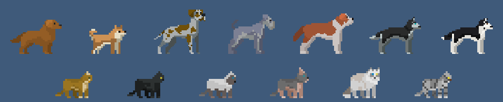
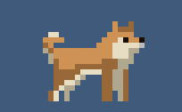
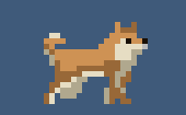
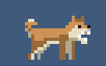

# TaskBeacon

TaskBeacon 是一个 local-first 的桌面任务状态监视器。它把来源不同、可信度不同的任务观测信号归一化为统一状态，并通过始终置顶的小卡片、任务面板和系统托盘展示。当前实现支持 Demo 场景，以及对外部 Terminal 中 Codex rollout/session JSONL 和 Claude Code transcript JSONL 的被动增量观察。

## 效果展示

Codex 和 Claude Code 各有一只桌面宠物，宠物的动作实时反映对应工具的任务状态。内置 7 种狗和 6 种猫，右键宠物即可切换：

<p align="center"></p>

以默认的秋田犬为例，不同任务状态下的动作：

<table>
  <tr>
    <td align="center" width="25%"><br><b>思考中</b><br><sub>模型正在推理或生成回复</sub></td>
    <td align="center" width="25%"><br><b>使用工具</b><br><sub>读写文件、搜索、调用工具</sub></td>
    <td align="center" width="25%"><br><b>执行命令</b><br><sub>运行命令、测试或构建</sub></td>
    <td align="center" width="25%"><br><b>完成</b><br><sub>一轮任务成功结束</sub></td>
  </tr>
  <tr>
    <td align="center" width="25%"><br><b>需要注意</b><br><sub>失败、等待审批或等待输入</sub></td>
    <td align="center" width="25%"><br><b>可能卡住</b><br><sub>长时间没有任何进展</sub></td>
    <td align="center" width="25%"><br><b>空闲</b><br><sub>空闲 30 秒后趴下，随后入睡</sub></td>
    <td></td>
  </tr>
</table>

## 环境与构建

- JDK 21
- Gradle 8.14+（可先用已安装 Gradle 执行 `gradle wrapper`）

```powershell
./gradlew.bat test
./gradlew.bat :app:run --args="--demo"
```

Linux/macOS：

```bash
./gradlew test
./gradlew :app:run --args="--demo"
```

## 运行模式

- 默认：同时被动观察 Codex 的 `$CODEX_HOME/sessions` 和 Claude Code 的 `$CLAUDE_CONFIG_DIR/projects`；未设置环境变量时分别使用用户目录下的 `.codex/sessions` 与 `.claude/projects`。
- `--demo`：只运行内置演示源；演示多任务、子任务、审批、stall 恢复和完成。
- `--with-demo`：被动 Codex、Claude Code 观察与 Demo 同时运行。

直接启动（默认同时观察 Codex 与 Claude Code）：

```powershell
./gradlew.bat :app:run
```

随后可在任意其他 Terminal 启动 `codex`。TaskBeacon 不处于 Codex 执行链路中；关闭或崩溃不会阻塞 Codex。

也可以在其他 Terminal 启动 `claude`。TaskBeacon 会只读增量观察
`${CLAUDE_CONFIG_DIR:-~/.claude}/projects/**/*.jsonl`，无需修改 Claude Code 配置；只保留任务状态、时间、工作目录和工具名称，不保留 prompt、回复、工具输入或工具输出。

## 配置与日志

首次运行会创建安全默认配置：

- Windows：`%LOCALAPPDATA%\TaskBeacon\config.json`
- macOS：`~/Library/Application Support/TaskBeacon/config.json`
- Linux：`${XDG_CONFIG_HOME:-~/.config}/taskbeacon/config.json`

日志位于同目录的 `logs/`。默认不记录或持久化完整 prompt、assistant 回复、文件内容、原始 rollout payload 或完整敏感命令。

## 内置宠物素材

宠物模式中的 Codex 和 Claude Code 各有独立宠物；未选择其他图片时，两者默认使用 Dog-2-Akita。右键任一宠物可从“内置宠物”菜单中分别选择 7 种狗（含 Border Collie）或 6 种猫，也可继续选择自定义图片。重置默认会恢复该宠物为 Akita；已有的自定义选择会保留，直到用户主动更换或重置。

原始 Pet Dogs Pack 和 Pet Cats Pack 的图片、预览图、特效图及各自的 `License.txt` 已一并收入 `ui-desktop/src/main/resources/pets/`，并随应用打包。两份原附许可证均标记为 CC0，并注明可用于商业及非商业项目。内置的 Border Collie 基于同一 CC0 狗素材包中的 Siberian Husky 重新配色，并修改了耳尖、白色领圈和尾巴，因此画风、尺寸和动作与其他狗保持一致；生成脚本见 `tools/pets/make_border_collie.py`。README 中的宠物展示动图由 `tools/readme/make_readme_media.py` 根据内置素材生成，素材更新后在仓库根目录重新运行即可。程序运行时会将选中的品种提取到用户的 TaskBeacon 皮肤目录，因此不依赖下载目录。

## 当前限制

- 首轮按照设计文档 v0.2 的 Milestone 1–3 实现；Claude/Codex Hook、App Server、Pet Renderer 和 Local Event API 尚未实现。
- SessionLog/transcript 是 best-effort 被动观测。上游协议变化应分别隔离在 `source-codex` 或 `source-claude` 中修复。
- 当前被动 Provider 使用低频增量 rescan；cursor 可恢复漏事件、partial line 和 truncate，原生 WatchService 可在后续加入以降低活跃时延。
- `codex exec --json` 的 fixture 与解释边界已预留，但完整 managed-process Provider 属于下一轮。
- 系统不支持 AWT SystemTray 时，悬浮卡片仍可运行。

## 打包

Windows 可生成包含内置 Java 运行时、可直接双击启动的应用目录：

```powershell
./gradlew.bat :app:portableExe
```

入口文件位于 `release/TaskBeacon/TaskBeacon.exe`。整个 `TaskBeacon` 目录是完整应用，不能只复制其中的 `.exe`。项目根目录的 `TaskBeacon.bat` 可直接双击启动该程序。修改源码后需要重新执行上述命令生成新版本。

`jpackage` 产物按宿主 OS 构建，不做跨平台安装包交叉编译；生成 Windows 安装器还需要 WiX Toolset。
